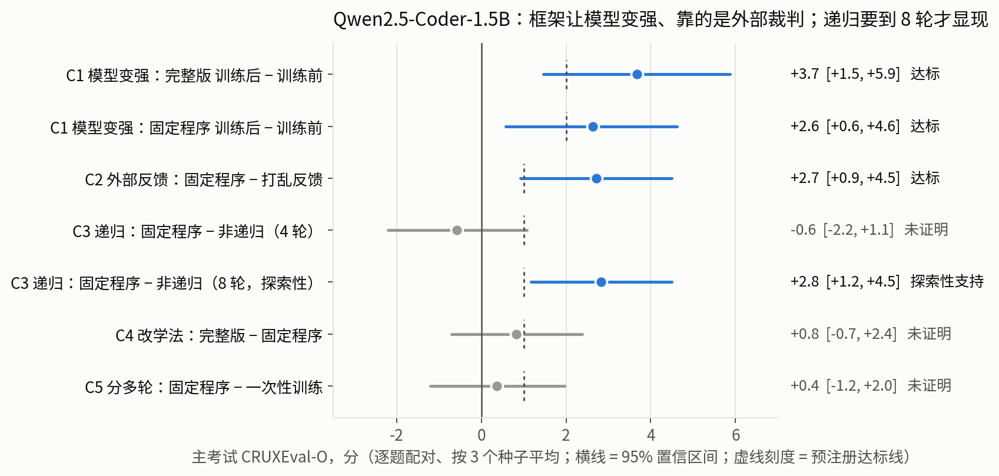
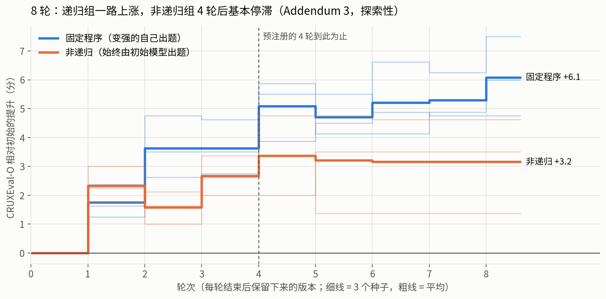
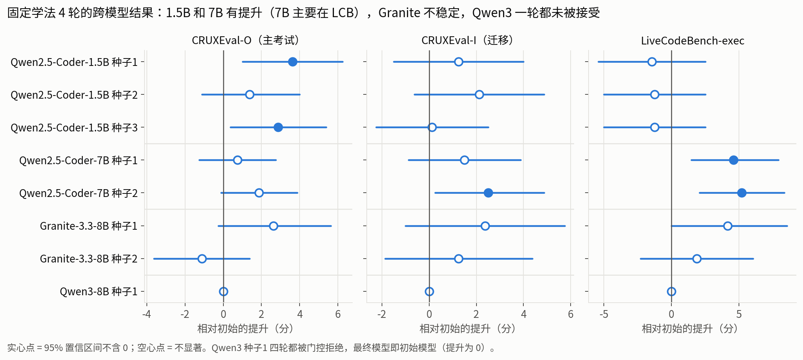

# RSI 框架实验进展（截至 2026-10-27 05:00 北京时间）

**三句话：**

1. 在 Qwen2.5-Coder-1.5B 上，按预注册标准**正式证明框架让模型变强**：完整版主考试 +3.7 分。提升靠的是外部裁判：把裁判的对错打乱后就不涨。
2. **递归的作用要轮数够多才显现**：8 轮时，"由变强的自己出题"比"始终由初始模型出题"多涨 2.8 分；后者到第 4–5 轮就停滞。这一条是探索性结论，判定标准在开跑前写好。
3. **跨模型初步结果：**
    - Qwen2.5-Coder-7B：两个种子在没练过的 LiveCodeBench-exec 上都显著上涨（+5.2 / +4.6）。
    - Granite-8B：一个种子涨，一个不涨。
    - Qwen3-8B：每一轮都没通过小测验，最终模型就是初始模型，没有变差。
    - 能调学法的完整版在这三个模型上都还在跑。

所有数字由 [`scripts/report/make_progress.py`](../../scripts/report/make_progress.py) 从 `results/` 直接生成，完整数据见 [tables.md](tables.md)。

## 图 1：预注册的五个问题（1.5B，3 个种子 × 4 轮）



- 每一行是一组对照比较。圆点是平均提升，横线是 95% 置信区间，虚线刻度是事先写好的达标线。
- 蓝色表示达标，灰色表示未证明。
- 主考试是 CRUXEval-O：给一段程序和输入，预测输出，共 800 题。
- 独立写的第二套打分器重算了全部测试记录，一致率 99.6–100%。

## 图 2：8 轮实验，递归什么时候起作用



- **对比的两组：** 蓝色是固定程序组，每轮由变强后的自己出题；橙色是非递归组，永远由初始模型出题。
- **前 4 轮：** 两组涨得差不多，所以预注册的 4 轮实验看不出递归的作用。
- **第 5–8 轮：** 固定程序组的小测验又上涨了 8 次，非递归组只有 2 次，到第 8 轮两组相差 2.8 分（95% 区间 +1.2 ~ +4.5）。
- **文献对照：** Kim et al. 2026（arXiv 2601.08421）报告，只用初始策略样本的学习会提前饱和，和这里的形状一致。

## 图 3：跨模型（固定学法，4 轮）



- **固定学法不能直接迁移：** 学法是在 1.5B 上选定后冻结的，对强模型（Qwen3）太简单，对 Granite 不稳定。
- **完整版才是 C1 的判定口径：** 预注册里"模型变强"（C1）本来就以完整版为准，它能自己调整出题难度和学习强度。三个模型的完整版都在跑。

## 实验进度表

| 实验 | 平台 | 状态 |
| --- | --- | --- |
| 1.5B：完整版 / 固定程序 / 非递归 / 打乱反馈 / 一次性训练，各 3 个种子，4 轮 | A800 + 百度 | 完成，五个问题均已正式判定 |
| 1.5B：8 轮的固定程序 vs 非递归，各 3 个种子 | 百度 | 完成，探索性结论 |
| Qwen2.5-Coder-7B：固定程序种子 1、2 | A800 / 百度 | 完成 |
| Qwen2.5-Coder-7B：固定程序种子 3；完整版种子 1、2 | A800 / 百度 | 进行中 |
| Granite-3.3-8B：固定程序种子 1、2；打乱反馈种子 1 | 百度 | 完成 |
| Granite-3.3-8B：固定程序种子 3；完整版种子 1、2 | 百度 | 进行中 / 排队 |
| Qwen3-8B：固定程序种子 1 | A800 | 完成（四轮都未通过小测验） |
| Qwen3-8B：固定程序种子 2；完整版种子 1 | A800 | 进行中 |
| OpenVLA × LIBERO：两次基线（74.8% / 76.4%）、1 轮试运行 | A800 | 完成 |
| OpenVLA × LIBERO：4 组 × 2 个种子，每组 3 轮 | A800 | 2 组进行中，6 组排队 |
| Meta CWM-32B | A800 | 只测了基线 |

基线、各种子明细和 8 轮逐轮数据见 [tables.md](tables.md)。预注册文件在 [`docs/prereg/`](../../docs/prereg/)。

## 重新生成

```bash
python -m rsi.audit.compare_arms results --suite cruxeval_o --json results/claims_cruxeval_o.json
python -m rsi.audit.compare_arms results --suite cruxeval_o --study long8 --json results/claims_long8_cruxeval_o.json
python scripts/report/make_progress.py results reports/progress
```
